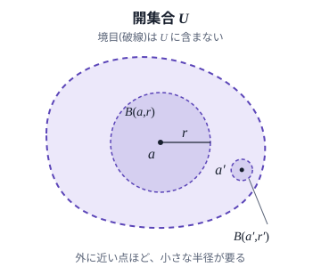
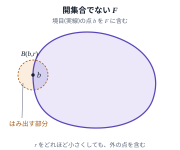

::: goal
距離空間の開集合と閉集合を定義し、閉集合を点列の極限で言い換えられるようになる。また、写像の連続性を ε-δ の形と「開集合の逆像が開集合」の形の二通りに述べて、二つが同じ条件であることを証明できるようになる。
:::

::: goal {field=physics}
微分方程式を開集合の上で考える理由を、点電荷のポテンシャルを例に説明できるようになります。また、測った初期条件や境界条件から予言を出すのに要る「条件の小さな誤差は、予言の小さな誤差にしかならない」という性質を連続性として述べ、それが成り立たない問題の設定の例を挙げられます。
:::

::: goal {field=cs}
プログラムを入力から出力への写像とみて、「入力の誤差を十分に小さくすれば、出力の誤差をいくらでも小さくできる」という性質を ε-δ で述べられるようになります。また、階段関数のように、ある点で連続でない関数では、その点の近くで入力の誤差がどれほど小さくても出力が大きく変わりうることを説明できます。
:::

::: motivation
温度計の読みには誤差があります。誤差が 0.1 度未満とわかっている温度計で 20.5 度と読めたら、本当の温度は 20.4 度より高いので、「20 度より高い」と言い切れます。精度をいくらでも上げられる温度計があるとすれば、本当の温度が 20 度より高いときは、精度を十分に上げることで、いつかはこう言い切れます。ところが「ちょうど 20 度である」ことは、どれほど精度のよい温度計でも言い切れません。読みのまわりの誤差の幅には、20 度でない温度も必ず入っているからです。

二つの条件の違いは、条件をみたす値を少しずらしたときに、条件が保たれるかどうかです。20.3 度は 0.3 度未満ずらしても 20 度より高いままですが、20 度はどれほど小さくずらしても 20 度でなくなります。どの点にも少しずらす余裕がある集合を、開集合と呼びます。

連続性も、この「少しずらす」で述べられます。関数が連続であるとは、出力のずれをどれほど小さく抑えたくても、入力のずれを十分に小さくすれば抑えられることです。出力の許容誤差 $\varepsilon$ を先に決め、それに応じて入力の許容誤差 $\delta$ を選ぶ、という順で述べるのが ε-δ の定義です。この定義は距離の値を使って書かれます。それなのに、平面の距離を [[@metric-space]] の $d_1$、$d_2$、$d_\infty$ のどれにしても、平面の上で連続な関数は変わりません(この章の終わりで確かめます)。連続性に要るのは、距離の値そのものなのでしょうか。
:::

::: motivation {field=physics}
物理の方程式には、成り立つ場所が添えられています。原点に置いた点電荷のポテンシャルがラプラス方程式をみたすのは、原点を除いた空間の上です。この集合は、どの点のまわりにも少し動く余裕がある集合、つまり開集合です。偏微分を両側からの極限として考えるには、この余裕が要ります。

もう一つ、測定には誤差があります。測った初期条件や境界条件から予言を出すには、条件の誤差が小さければ予言の誤差も小さい、という性質が要ります。これは、条件から予言への対応が連続であるという要求です。この要求が成り立たない問題の設定の例も、この章で見ます。
:::

::: motivation {field=cs}
倍精度の浮動小数点数 (IEEE 754 の binary64) で、既定の丸め方(表せる数のうち、いちばん近いものに丸める)で計算すると、`0.1 + 0.2 == 0.3` は偽になります。0.1 も 0.2 も 2 進数では有限の桁で書けないので丸めて記録され、丸めた値どうしの和をさらに丸めた結果が、0.3 を丸めた値と一致しないからです。浮動小数点数で表した値には丸めの誤差があり、その誤差で判定や出力がどれだけ動くかが問題になります。

等号による判定は、誤差がどれほど小さくても結果が変わりうる判定です。一方、$x > 0$ のとき、誤差が $x$ 未満の近似値 $a$ について $a > 0$ を判定すると、正しい答え(真)が出ます。この違いは、この章で定める開集合と、そうでない集合の違いにあたります。入力の誤差が出力の誤差にどう伝わるかは、連続性の言葉で述べられます。
:::

この章では、まず距離空間の開球と開集合を定め、開集合の性質を調べます。補集合が開集合になる閉集合も定め、点列の極限で言い換えます([[@open-set]])。次に、写像の連続性を ε-δ で定め、それが「開集合の逆像が開集合」と同値であることを示します([[@continuous-map]])。後者の言い換えには距離の値が出てこないので、出発点の問いに答えられます。距離のない空間で連続性を定めるときにも、この言い換えが出発点になります([[@topological-spaces]])。

## 開集合 {#open-set requires=metric-space,sets-maps}

::: summary
どの点のまわりにも、その点を中心とする小さな球がまるごと収まる集合。
:::

::: why
[[点列の収束]]の定義は、「$x$ から $\varepsilon$ 未満の所」という範囲に、ある番号から先の項がすべて入るかどうかだけを問います。[[@metric-space]] の落とし穴で見たように、$\mathbb{R}^m$ の $d_1$、$d_2$、$d_\infty$ は値が違うのに、収束する点列は同じでした。

$d_1$、$d_2$、$d_\infty$ のように、互いに定数倍で上から抑え合う距離のあいだで変わらないものを取り出すために、点のまわりの範囲に開球という名前を付け、どの点のまわりにも開球が収まる集合を開集合と呼びます。どんな距離に変えても変わらないわけではありません(下の例の離散距離)。出発点の「少しずらしても条件が保たれる」を、距離空間の言葉で書いたものです。
:::

::: definition {#open-ball name="開球" en="open ball"}
[[距離空間]] $(X, d)$ の点 $a$ と実数 $r > 0$ について、集合

$$
B(a, r) := \{x \in X \mid d(x, a) < r\}
$$

を、$a$ を中心とする半径 $r$ の開球という。
:::

::: definition {name="開集合" en="open set"}
距離空間 $(X, d)$ の部分集合 $U$ が開集合であるとは、次が成り立つことをいう($B(a, r)$ は[[開球]])。

$$
\forall a \in U\ \ \exists r > 0:\quad B(a, r) \subset U
$$
:::

$U$ のどの点 $a$ についても、半径 $r$ をうまく選べば、$a$ を中心とする開球 $B(a, r)$ が $U$ からはみ出さない、ということです([[@fig-open-set]] の (a))。$r$ は点 $a$ ごとに選んでかまいません。$U$ の外の点に近い点ほど、小さな $r$ が要ります。開球は $d(x, a) < r$ で定めたので、$d(x, a) = r$ となる点 $x$ を含みません。

 {#fig-open-set}

::: examples
- 実数全体 $\mathbb{R}$(距離は $d(x, y) = |x - y|$)で、開区間 $(0, 1)$ は開集合です。点 $a \in (0, 1)$ に対して $r = \min(a, 1 - a)$ とすると、$B(a, r) = (a - r, a + r)$ は $(0, 1)$ に収まります。
- 区間 $(0, 1]$ は開集合ではありません。点 $1$ を中心とする開球 $B(1, r) = (1 - r, 1 + r)$ は、どの $r > 0$ についても $1 + r/2$ を含み、$(0, 1]$ からはみ出します。
- 1点だけの集合 $\{0\}$ は開集合ではありません。どの $r > 0$ についても、$B(0, r)$ は $r/2$ を含みます。出発点の「ちょうど 20 度」がこれにあたります。
- 平面 $\mathbb{R}^2$(距離は $d_2$)の上半分 $H = \{(y_1, y_2) \in \mathbb{R}^2 \mid y_2 > 0\}$ は開集合です。点 $a = (a_1, a_2) \in H$ に対して $r = a_2$ とします。$d_2(y, a) < a_2$ をみたすどの点 $y$ も、$|y_2 - a_2| \le d_2(y, a) < a_2$ から $y_2 > 0$ となり、$H$ に入ります。
- 離散距離(異なる2点の距離をすべて 1 とする距離)では、どの点 $a$ についても $B(a, 1) = \{a\}$ なので、どの部分集合 $U$ も開集合です。$U$ のどの点 $a$ についても、$r = 1$ とすれば $B(a, 1) = \{a\} \subset U$ だからです。

$\mathbb{R}^m$ の $d_1$、$d_2$、$d_\infty$ では、開集合は同じになります。距離 $d$ での開球を $B_d(a, r)$ と書くと、[[@metric-space]] の不等式 $d_\infty \le d_2 \le d_1 \le m\, d_\infty$ から

$$
B_{d_1}(a, r) \subset B_{d_2}(a, r) \subset B_{d_\infty}(a, r) \subset B_{d_1}(a, mr)
$$

が成り立ちます(たとえば最後の包含は、$d_\infty(x, a) < r$ をみたすどの $x$ についても $d_1(x, a) \le m\, d_\infty(x, a) < mr$ となるから)。$U$ が $d_2$ か $d_\infty$ で開集合なら、$U$ の各点 $a$ でその距離の開球 $B(a, r)$ が $U$ に収まり、その内側にある $B_{d_1}(a, r)$ も $U$ に収まるので、$U$ は $d_1$ で開集合です。$U$ が $d_1$ で開集合なら、$B_{d_1}(a, r) \subset U$ となる $r$ について $B_{d_2}(a, r/m) \subset B_{d_\infty}(a, r/m) \subset B_{d_1}(a, r) \subset U$ なので、$U$ は $d_2$ でも $d_\infty$ でも開集合です。平面($m = 2$)では、開球は $d_1$ で菱形、$d_2$ で円、$d_\infty$ で正方形の、それぞれ周を含まない内側になります。形は違っても、どの開球の中にもほかの距離の開球が収まるので、開集合は同じになります。
:::

開球は、実際に開集合になります。ただし、これは開球の定義からすぐには出てこず、三角不等式を使って示します。

::: theorem {#open-ball-is-open name="開球は開集合"}
距離空間 $(X, d)$ の開球 $B(a, r)$ は開集合である。
:::

::: proof-sketch
1. 点 $x \in B(a, r)$ をとり、$s := r - d(x, a)$ とおくと $s > 0$ である(開球の定義を使う)。
2. $B(x, s)$ のどの点 $y$ についても、$d(y, a) \le d(y, x) + d(x, a) < s + d(x, a) = r$ となる(三角不等式を使う)。
3. よって $B(x, s) \subset B(a, r)$ で、$x$ は $B(a, r)$ のどの点でもよいので、$B(a, r)$ は開集合である(開集合の定義を使う)。
:::

::: proof
$x \in B(a, r)$ を任意にとります。開球の定義から $d(x, a) < r$ なので、$s := r - d(x, a)$ は正です。

$y \in B(x, s)$ を任意にとると、$d(y, x) < s$ で、三角不等式から

$$
d(y, a) \le d(y, x) + d(x, a) < s + d(x, a) = r
$$

なので、$y \in B(a, r)$ です。したがって $B(x, s) \subset B(a, r)$ です。$x$ は $B(a, r)$ の任意の点だったので、$\forall x \in B(a, r)\ \exists s > 0: B(x, s) \subset B(a, r)$ が成り立ちます。これは、$B(a, r)$ が開集合であるということです。
:::

::: drop-assumption
**三角不等式を外す。** 閉区間 $[0, 1]$ に点 $2$ を加えた集合 $X = [0, 1] \cup \{2\}$ に $d(x, y) = |x - y|$ と定め、$d(0, 2) = d(2, 0) = 1/2$ だけを変えます。正値性と対称性は成り立ちますが、$d(2, 1/2) = 3/2 > 1 = d(2, 0) + d(0, 1/2)$ なので、三角不等式は成り立ちません。この「距離」では、$(0, 1]$ のどの点 $x$ も $d(2, x) = 2 - x \ge 1$ をみたすので、$B(2, 1) = \{0, 2\}$ です。ところが点 $0$ を中心とする開球 $B(0, s)$ は、どの $s > 0$ についても $(0, 1]$ の点 $\min(s, 1)/2$ を含むので、$\{0, 2\}$ に収まりません。開球 $B(2, 1)$ は開集合ではありません。証明の2段目で、$d(y, 2)$ を $d(y, 0) + d(0, 2)$ で上から抑えられないことが原因です。
:::

### 和集合と共通部分

開集合の[[和集合]]や[[共通部分]]をとると、新しい開集合が作れます。

::: theorem {#open-set-operations name="開集合の和集合と共通部分"}
距離空間 $(X, d)$ について、次が成り立つ。

1. 空集合 $\emptyset$ と $X$ は開集合である。
2. 開集合をいくつ集めても(無限個でもよい)、その和集合は開集合である。
3. 有限個の開集合の共通部分は開集合である。
:::

::: proof-sketch
1. $\emptyset$ には点がないので開集合の条件は真で、$X$ にはどの開球も収まる(空集合の上の「すべての」は真であることと、開球は $X$ の部分集合であることを使う)。
2. 集めた開集合を添字 $\lambda$ で区別して $U_\lambda$ と書く。和集合の点 $a$ はある $U_\lambda$ に属し、その $U_\lambda$ に収まる開球 $B(a, r)$ は、和集合にも収まる($U_\lambda$ が開集合であることを使う)。
3. 共通部分の点 $a$ について、$U_i$ ごとに $B(a, r_i) \subset U_i$ となる $r_i$ をとり、$r = \min(r_1, \dots, r_k)$ とすると、$B(a, r)$ はどの $U_i$ にも収まる(有限個の正の数の最小値は正であることを使う)。
:::

::: proof
**1.** $\emptyset$ について、開集合の条件 $\forall a \in \emptyset\ \exists r > 0: B(a, r) \subset \emptyset$ は、$a \in \emptyset$ となる $a$ がないので真です([[@reading-symbols]] の落とし穴)。$X$ については、どの $a \in X$ についても $B(a, 1) \subset X$ です(開球は $X$ の部分集合として定めた)。

**2.** 開集合の族 $(U_\lambda)_{\lambda \in \Lambda}$($\Lambda$ は無限集合でもよい)の和集合を $V = \bigcup_{\lambda \in \Lambda} U_\lambda$ とします。$a \in V$ なら、ある $\lambda$ で $a \in U_\lambda$ です。$U_\lambda$ は開集合なので、$B(a, r) \subset U_\lambda$ となる $r > 0$ があり、$U_\lambda \subset V$ から $B(a, r) \subset V$ です。$a$ は $V$ の任意の点だったので、$V$ は開集合です。

**3.** 開集合 $U_1, \dots, U_k$ の共通部分を $W = U_1 \cap \dots \cap U_k$ とします。$a \in W$ なら、どの $i$ についても $a \in U_i$ なので、$B(a, r_i) \subset U_i$ となる $r_i > 0$ があります。$r = \min(r_1, \dots, r_k)$ は、有限個の正の数の最小値なので正です。$r \le r_i$ から、どの $i$ についても $B(a, r) \subset B(a, r_i) \subset U_i$ が成り立つので、$B(a, r) \subset W$ です。$a$ は $W$ の任意の点だったので、$W$ は開集合です。
:::

::: drop-assumption
**「有限個」を外す。** $\mathbb{R}$ の開区間 $U_n = (-1/n, 1/n)$($n$ は正の整数)はどれも開集合ですが、すべての $n$ についての共通部分は $\{0\}$ で、開集合ではありません。$0$ はどの $U_n$ にも属し、$x \ne 0$ は $n > 1/|x|$ となる $U_n$ には属さないからです。証明の3段目で、点 $0$ について $B(0, r_n) \subset U_n$ となる半径は $r_n \le 1/n$ に限られるので、すべての $U_n$ に収まる開球はとれません。
:::

この三つの性質は、[[@topological-spaces]] で、距離を使わずに開集合を定めるときの公理 (axiom) になります。

### 閉集合

::: definition {#closed-set name="閉集合" en="closed set"}
距離空間 $(X, d)$ の部分集合 $F$ が閉集合であるとは、[[補集合]] $X \setminus F$ が開集合であることをいう。
:::

たとえば $\mathbb{R}$ の閉区間 $[0, 1]$ は閉集合です。補集合 $(-\infty, 0) \cup (1, \infty)$ は、その点 $a$ について、$a < 0$ なら $r = -a$、$a > 1$ なら $r = a - 1$ とすれば開球 $B(a, r)$ が収まるので、開集合です。閉集合は、点列の極限を使って言い換えられます。

::: theorem {#closed-set-limits name="閉集合と点列の極限"}
距離空間 $(X, d)$ の部分集合 $F$ について、次の二つは同値である。

1. $F$ は閉集合である。
2. $F$ の点からなる[[点列]]が $X$ の点 $x$ に収束するなら、$x \in F$ である。
:::

::: proof-sketch
1. 条件 1 を仮定し、$F$ の点からなる点列の極限 $x$ が $F$ の外にあるとすると、$x$ を中心とする開球 $B(x, r)$ で、$F$ の点を含まないものがある(閉集合の定義を使う)。
2. 点列の項はどれも $F$ にあって $B(x, r)$ に入らないので、$x$ に収束しない(収束の定義を使う)。
3. 条件 2 を仮定する。$X \setminus F$ が開集合でないとすると、ある $x \notin F$ について、どの正の整数 $n$ でも $B(x, 1/n)$ が $F$ の点 $x_n$ を含む(開集合の条件の否定を使う)。
4. この点列は $x$ に収束するので、条件 2 から $x \in F$ となり、$x \notin F$ と矛盾する(アルキメデスの性質と条件 2 を使う)。
:::

::: proof
**条件 1 から条件 2.** $F$ が閉集合で、$F$ の点からなる点列 $(x_n)$ が $x \in X$ に収束するとします。$x \notin F$ と仮定すると $x \in X \setminus F$ で、$X \setminus F$ は開集合なので、$B(x, r) \subset X \setminus F$ となる $r > 0$ があります。どの $x_n$ も $F$ に属するので $B(x, r)$ には入らず、すべての $n$ について $d(x_n, x) \ge r$ です。すると $\varepsilon = r$ に対しては、どの番号 $N$ も収束の定義の条件をみたさず、$x_n \to x$ に反します。よって $x \in F$ です。

**条件 2 から条件 1.** 条件 2 が成り立つとし、$X \setminus F$ が開集合でないと仮定します。開集合の条件の否定は、量化子を取り替えて「ある $x \in X \setminus F$ があって、どの $r > 0$ についても $B(x, r) \subset X \setminus F$ でない」、つまり「$B(x, r)$ が $F$ の点を含む」です。各正の整数 $n$ について、$B(x, 1/n)$ に含まれる $F$ の点を一つ選んで $x_n$ とします。任意の $\varepsilon > 0$ に対して $N > 1/\varepsilon$ となる番号 $N$ を選べば(アルキメデスの性質)、すべての $n \ge N$ について $d(x_n, x) < 1/n \le 1/N < \varepsilon$ なので、$x_n \to x$ です。条件 2 から $x \in F$ ですが、これは $x \in X \setminus F$ に反します。よって $X \setminus F$ は開集合で、$F$ は閉集合です。
:::

::: drop-assumption
**「閉集合」を外す。** $\mathbb{R}$ の区間 $F = (0, 1]$ は閉集合ではありません。補集合 $(-\infty, 0] \cup (1, \infty)$ の点 $0$ を中心とする開球は、どれも $(0, 1]$ の点を含むからです。実際、$F$ の点からなる点列 $x_n = 1/n$ は $0$ に収束しますが、極限 $0$ は $F$ に属しません。
:::

::: pitfall
- 開集合と閉集合は、反対の意味の言葉ではありません。$\mathbb{R}$ の区間 $(0, 1]$ は開集合でも閉集合でもなく、$\mathbb{R}$ と $\emptyset$ は開集合でもあり閉集合でもあります(互いの補集合で、どちらも開集合だから)。「開集合でない」から「閉集合である」は出てきません。
- 開集合かどうかは、全体の集合 $X$ によって変わります。距離空間 $(X, d)$ の部分集合 $Y$ に、$Y$ の2点の距離を $d$ のまま測る距離を入れると、$Y$ も距離空間になります(距離の三つの性質はそのまま成り立つ)。これを $X$ の部分空間 (subspace) と呼びます。$Y = [0, 1]$ の中では、$[0, 1)$ は開集合です。点 $a \in [0, 1)$ に対して $r = 1 - a$ とすると、$Y$ の中の開球 $\{y \in [0, 1] \mid |y - a| < 1 - a\}$ は $[0, 1)$ に収まるからです。$\mathbb{R}$ の中では、点 $0$ のまわりに開球が収まらないので、$[0, 1)$ は開集合ではありません。「$U$ は開集合」と書くときは、どの空間の開集合かを確かめます。
:::

::: application {field=physics title="点電荷のポテンシャルの定義域"}
原点に置いた点電荷 $q$ のつくる静電ポテンシャルは、SI 単位系で

$$
\phi(x) = \frac{q}{4\pi\varepsilon_0 |x|}
$$

で、原点では定まりません($|x|$ は $\mathbb{R}^3$ の点 $x$ の原点からの直線距離、$\varepsilon_0$ は真空の誘電率)。$\phi$ が定まる集合 $U = \mathbb{R}^3 \setminus \{0\}$ は開集合です。点 $x \in U$ に対して半径 $|x|$ の開球 $B(x, |x|)$ をとると、$d_2(0, x) = |x|$ は $|x|$ 未満ではないので、原点はこの開球に入らないからです。

$U$ が開集合なら、$U$ のどの点でも、どの座標の方向にも偏微分を考えられます。$e_1 = (1, 0, 0)$ とすると、点 $x$ での $x_1$ 方向の偏微分は、商 $(\phi(x + he_1) - \phi(x))/h$ の $h \to 0$ での極限で、正の $h$ でも負の $h$ でも $\phi(x + he_1)$ が定まっている必要があります。$B(x, r) \subset U$ なら、$|h| < r$ をみたすどの $h$ についても $x + he_1 \in U$ です。そこで $U$ のどの点でも偏微分を計算でき、

$$
\frac{\partial}{\partial x_1}\frac{1}{|x|} = -\frac{x_1}{|x|^3}, \qquad \frac{\partial^2}{\partial x_1^2}\frac{1}{|x|} = -\frac{1}{|x|^3} + \frac{3x_1^2}{|x|^5}
$$

です。$x_2$、$x_3$ についても同じ形の式が成り立つので、三つを足すと $-3/|x|^3 + 3(x_1^2 + x_2^2 + x_3^2)/|x|^5 = 0$ となり、$U$ の上でラプラス方程式 $\Delta\phi = 0$ が成り立ちます($\Delta$ は三つの座標についての2階の偏微分の和)。電荷のある原点まで含めて扱うには、ポアソン方程式 $\Delta\phi = -\rho/\varepsilon_0$ と、点電荷の電荷密度 $\rho$ を表すデルタ関数が要ります。これはこの章の範囲を超えるので、ここでは扱いません。
:::

## 連続写像 {#continuous-map requires=open-set}

::: summary
入力のずれを十分に小さくすれば出力のずれをいくらでも小さくでき、開集合の逆像が必ず開集合になる写像。
:::

::: why
[[開集合]]は、一つの空間の中で、点のまわりに少しずらす余裕があることを述べる言葉でした。初期条件から解がただ一つに決まる物理の問題や、入力から出力を計算するプログラムは、ある空間の点(入力)を別の空間の点(出力)に写す写像とみなせます。入力は測定や丸めの誤差を含むので、二つの空間のあいだで、入力の小さなずれが出力の小さなずれにしかならないことを確かめたい場面があります。これが連続性です。

連続性は、[[@convergence]] の ε-N と同じ形の ε-δ で定めます。ただ、ε-δ の定義は距離の値で書かれていて、距離を $d_1$、$d_2$、$d_\infty$ のどれにするかで連続性が変わるのかは、定義を見ただけではわかりません。この駅では、連続性が開集合だけで言い換えられることを示し、この問いに答えます。
:::

::: definition {name="連続写像" en="continuous map" aliases="連続,連続関数"}
[[距離空間]] $(X, d_X)$ から $(Y, d_Y)$ への写像 $f: X \to Y$ が点 $a \in X$ で連続であるとは、次が成り立つことをいう。

$$
\forall \varepsilon > 0\ \ \exists \delta > 0\ \ \forall x \in X:\quad d_X(x, a) < \delta \Rightarrow d_Y(f(x), f(a)) < \varepsilon
$$ {#epsilon-delta}

$f$ が $X$ のすべての点で連続であるとき、$f$ は連続である、または連続写像であるという。
:::

$X$ の距離と $Y$ の距離を区別するため、$d_X$、$d_Y$ と書きました。読み下すと、「出力の許容誤差 $\varepsilon$ をどんなに小さく決めても、入力のずれを $\delta$ 未満に抑えれば出力のずれが $\varepsilon$ 未満に収まる、という $\delta$ がある」です。$\delta$ は $\varepsilon$ と点 $a$ に応じて選んでかまいません。開球で書くと、「どの $\varepsilon > 0$ についても、ある $\delta > 0$ があって、$B(a, \delta)$ のどの点 $x$ についても $f(x) \in B(f(a), \varepsilon)$」です。

この最後の形を、$Y$ の部分集合を $f$ で $X$ へ引き戻した集合で書くために、逆像を定めます。

::: definition {#preimage name="逆像" en="preimage"}
写像 $f: X \to Y$ と $Y$ の部分集合 $V$ について、$f(x)$ が $V$ に入る点 $x$ の集合 $f^{-1}(V) := \{x \in X \mid f(x) \in V\}$ を、$f$ による $V$ の逆像という。
:::

逆像を使うと、点 $a$ での連続性は「どの $\varepsilon > 0$ についても、ある $\delta > 0$ で $B(a, \delta) \subset f^{-1}(B(f(a), \varepsilon))$」と書けます。

::: examples
- $\mathbb{R}$ から $\mathbb{R}$ への $f(x) = 2x + 1$ は連続です。$|f(x) - f(a)| = 2|x - a|$ なので、$\delta = \varepsilon/2$ とすれば、$|x - a| < \delta$ をみたすすべての $x$ で $|f(x) - f(a)| < \varepsilon$ です。$\delta$ は点 $a$ によりません。
- $\mathbb{R}$ から $\mathbb{R}$ への $f(x) = x^2$ も連続ですが、$\delta$ は点 $a$ によって選ぶ必要があります。$|x^2 - a^2| = |x - a|\,|x + a|$ で、$|x - a| < 1$ をみたす $x$ では $|x + a| \le |x - a| + 2|a| < 1 + 2|a|$ です。そこで $\delta = \min\bigl(1, \varepsilon/(1 + 2|a|)\bigr)$ とすれば、$|x - a| < \delta$ をみたすすべての $x$ で $|x^2 - a^2| < \delta(1 + 2|a|) \le \varepsilon$ です。この $\delta$ は、$|a|$ が大きくなっても大きくはならず、$1 + 2|a| > \varepsilon$ となる点では $|a|$ とともに小さくなります。点によらない $\delta$ はとれません。$\varepsilon = 1$ に対してすべての点で使える $\delta$ があったとすると、$a \ge 1/\delta$ と $x = a + \delta/2$ について、$|x - a| < \delta$ なのに $|x^2 - a^2| = \frac{\delta}{2}\bigl(2a + \frac{\delta}{2}\bigr) > a\delta \ge 1$ となるからです。
- 距離空間 $(X, d)$ の点 $b$ を決めて $g(x) = d(x, b)$ とすると、$g: X \to \mathbb{R}$ は連続です。三角不等式から $d(x, b) \le d(x, a) + d(a, b)$ と $d(a, b) \le d(a, x) + d(x, b)$ が成り立ち、対称性と合わせて $|g(x) - g(a)| \le d(x, a)$ となるので、$\delta = \varepsilon$ とすれば足ります。
- 連続写像は、収束する点列を、収束する点列に写します。$f$ が点 $a$ で連続で $x_n \to a$ とします。$\varepsilon > 0$ に対して $\delta$ を選び、その $\delta$ に対して、すべての $n \ge N$ で $d_X(x_n, a) < \delta$ となる番号 $N$ を選ぶと、すべての $n \ge N$ で $d_Y(f(x_n), f(a)) < \varepsilon$、つまり $f(x_n) \to f(a)$ です。
- 階段関数 (step function) $h$($x < 0$ で $h(x) = 0$、$x \ge 0$ で $h(x) = 1$)は、点 $0$ で連続ではありません。$\varepsilon = 1/2$ とすると、どの $\delta > 0$ についても、$x = -\delta/2$ は $|x - 0| < \delta$ をみたすのに $|h(x) - h(0)| = 1$ です。0 以外の点 $a$ では、$\delta = |a|$ とすれば $|x - a| < \delta$ の範囲で $h$ は一定なので、連続です。
- $X$ に離散距離を入れると、$X$ からどの距離空間 $Y$ への写像も連続です。$\delta = 1$ とすれば、$d_X(x, a) < 1$ となる $x$ は $a$ だけだからです。
:::

### 開集合による言い換え

::: theorem {#continuity-open-preimage name="連続性の開集合による言い換え"}
距離空間 $(X, d_X)$ から $(Y, d_Y)$ への写像 $f$ について、次の二つは同値である。

1. $f$ は連続である。
2. $Y$ のどの[[開集合]] $V$ についても、[[逆像]] $f^{-1}(V)$ は $X$ の開集合である。
:::

::: proof-sketch
1. 条件 1 を仮定し、$Y$ の開集合 $V$ と $a \in f^{-1}(V)$ をとると、$f(a) \in V$ で、$B(f(a), \varepsilon) \subset V$ となる $\varepsilon > 0$ がある($V$ が開集合であることを使う)。
2. その $\varepsilon$ に対して $B(a, \delta) \subset f^{-1}(B(f(a), \varepsilon)) \subset f^{-1}(V)$ となる $\delta > 0$ があるので、$f^{-1}(V)$ は開集合である($f$ の点 $a$ での連続性を使う)。
3. 条件 2 を仮定する。点 $a$ と $\varepsilon > 0$ について、$B(f(a), \varepsilon)$ は開集合なので、その逆像は $a$ を含む開集合になる(開球は開集合であることと、条件 2 を使う)。
4. 逆像が開集合なので $B(a, \delta) \subset f^{-1}(B(f(a), \varepsilon))$ となる $\delta > 0$ があり、これは $a$ での連続性の条件そのものである(開集合の定義を使う)。
:::

::: proof
**条件 1 から条件 2.** $f$ が連続で、$V$ が $Y$ の開集合だとします。$a \in f^{-1}(V)$ を任意にとると $f(a) \in V$ で、$V$ は開集合なので、$B(f(a), \varepsilon) \subset V$ となる $\varepsilon > 0$ があります。$f$ は $a$ で連続なので、この $\varepsilon$ に対して、$d_X(x, a) < \delta$ をみたすすべての $x$ で $d_Y(f(x), f(a)) < \varepsilon$ となる $\delta > 0$ があります。すると $B(a, \delta)$ のどの点 $x$ についても $f(x) \in B(f(a), \varepsilon) \subset V$ なので、$x \in f^{-1}(V)$ です。つまり $B(a, \delta) \subset f^{-1}(V)$ です。$a$ は $f^{-1}(V)$ の任意の点だったので、$f^{-1}(V)$ は開集合です。

**条件 2 から条件 1.** 条件 2 が成り立つとし、点 $a \in X$ と $\varepsilon > 0$ を任意にとります。開球 $B(f(a), \varepsilon)$ は開集合なので([[@open-ball-is-open]])、条件 2 からその逆像 $f^{-1}(B(f(a), \varepsilon))$ は $X$ の開集合です。$f(a) \in B(f(a), \varepsilon)$ なので、この逆像は $a$ を含みます。開集合の定義から $B(a, \delta) \subset f^{-1}(B(f(a), \varepsilon))$ となる $\delta > 0$ があり、これは「$d_X(x, a) < \delta$ をみたすすべての $x$ で $d_Y(f(x), f(a)) < \varepsilon$」ということです。$a$ と $\varepsilon$ は任意だったので、$f$ は連続です。
:::

::: drop-assumption
**「すべての点で連続」を「1点を除いて連続」に弱める。** 上の例の階段関数 $h$ は、0 以外のすべての点で連続です。開集合 $V = (1/2, 3/2)$ の逆像は $h^{-1}(V) = [0, \infty)$ で、これは開集合ではありません。点 $0$ を中心とする開球 $B(0, r)$ は、どの $r > 0$ についても $-r/2$ を含むからです。$[0, \infty)$ の点のうち開球が収まらないのは、$h$ が連続でない点 $0$ だけで、正の点 $a$ については $B(a, a) = (0, 2a) \subset [0, \infty)$ です。定理は、点ごとの形でも成り立ちます。$f$ が点 $a$ で連続であることは、$f(a)$ を含むどの開集合 $V$ についても、$f^{-1}(V)$ が $a$ を中心とする開球を含むことと同値です。証明は、上の証明の議論を点 $a$ だけに使えば得られます。
:::

定理の条件 2 には、距離の値が出てきません。出てくるのは、どの集合が開集合かということだけです。ここから次のことがわかります。

- 開集合が同じになる二つの距離は、同じ連続写像を与えます。[[@open-set]] の例で見たように、$\mathbb{R}^m$ の $d_1$、$d_2$、$d_\infty$ は開集合が同じなので、$X$ や $Y$ が $\mathbb{R}^m$ のとき、その距離をこの三つのどれにしても、連続な写像は変わりません。これが出発点の問いの答えです。
- 距離空間のあいだの連続写像 $f: X \to Y$ と $g: Y \to Z$ の[[合成]] $g \circ f$ は連続です。$Z$ の開集合 $W$ について $(g \circ f)^{-1}(W) = f^{-1}(g^{-1}(W))$ で、$g^{-1}(W)$ は $Y$ の開集合、その逆像は $X$ の開集合になるからです。
- 連続関数 $g: X \to \mathbb{R}$ と実数 $c$ について、$\{x \in X \mid g(x) < c\} = g^{-1}((-\infty, c))$ は開集合です。$t < c$ をみたすどの $t$ についても $B(t, c - t) \subset (-\infty, c)$ なので、$(-\infty, c)$ は $\mathbb{R}$ の開集合だからです。また、$(c, \infty)$ も同じ理由で開集合なので、$\{x \in X \mid g(x) \le c\}$ は開集合 $g^{-1}((c, \infty))$ の補集合で、閉集合です。上の例の $g(x) = d(x, b)$ に使うと、開球 $B(b, r)$ が開集合であることが改めてわかり、閉球 (closed ball) $\{x \in X \mid d(x, b) \le r\}$ は閉集合だとわかります。

::: pitfall
- 記号 $f^{-1}(V)$ は、$f$ に[[逆写像]]がなくても使えます。$f(x) = x^2$ には $\mathbb{R}$ 全体での逆写像がありませんが、$f^{-1}((1, 4)) = (-2, -1) \cup (1, 2)$ のように、逆像は定まります。
- 連続写像で開集合を写した[[像]]は、開集合とは限りません。$f(x) = x^2$ は連続ですが、開区間 $(-1, 1)$ の像は $[0, 1)$ で、点 $0$ のまわりに開球が収まらないので開集合ではありません。定理が述べているのは、像ではなく逆像についてです。
- 連続かどうかは、$X$ と $Y$ の距離によって変わります。$\mathbb{R}$ から $\mathbb{R}$ への[[恒等写像]] $\mathrm{id}(x) = x$ は、$d_X$ が離散距離で $d_Y(x, y) = |x - y|$ なら連続です(上の例)。逆に、$d_X(x, y) = |x - y|$ で $d_Y$ が離散距離なら、連続ではありません。$d_Y$ では $\{0\}$ が開集合ですが、その逆像 $\{0\}$ は $d_X$ での開集合ではないからです。$d_Y$ ではどの集合も開集合なので、この写像は開集合の像を必ず開集合に写します。「開集合の像が開集合」は、連続性の言い換えになりません。
:::

::: application {field=physics title="データへの連続な依存"}
電荷のない領域の静電ポテンシャル $\phi$ は、ラプラス方程式をみたします。ここでは $z$ 方向に一様な場合を考え、$\phi(x, y)$ が $\phi_{xx} + \phi_{yy} = 0$ をみたすとします($\phi_{xx}$ は $x$ についての2階の偏微分)。直線 $y = 0$ の上でポテンシャル $\phi(x, 0)$ と、その $y$ 方向の微分 $\phi_y(x, 0)$(電場の $y$ 成分の符号を変えたもの)を測り、そこから $0 \le y \le 1$ の領域でのポテンシャルを求める問題を考えます。

測定には誤差があるので、この問題から予言を出すには、データの誤差が小さければ解の誤差も小さいことが要ります。これを ε-δ で述べるために、データ $(\phi(x, 0), \phi_y(x, 0))$ から解 $\phi$ への対応を写像とみます(解がただ一つに決まることは、ここでは認めます)。関数は有界なものだけを考え、データの距離は二つの関数それぞれの sup 距離 $d_\infty$([[@metric-space]])の和、解の距離は直線 $y = 1$ の上での $d_\infty$ とします。ところが、この写像は連続ではありません。正の整数 $n$ について、$\sinh t = (e^t - e^{-t})/2$ を使って

$$
\phi_n(x, y) = \frac{\sin(nx) \sinh(ny)}{n^2}
$$

とおくと、$(\phi_n)_{xx} + (\phi_n)_{yy} = -\sin(nx)\sinh(ny) + \sin(nx)\sinh(ny) = 0$ で、データは $\phi_n(x, 0) = 0$、$(\phi_n)_y(x, 0) = \sin(nx)/n$ です。$0 \le y \le 1$ では $|\phi_n(x, y)| \le \sinh(n)/n^2$ なので、$\phi_n$ はこの領域で有界です。一方、データがどちらも 0 なら $\phi = 0$ が解です。二つのデータの距離は $0 + \sup_x |\sin(nx)/n| = 1/n$ ですが、解の距離は $\sup_x |\phi_n(x, 1)| = \sinh(n)/n^2$ です。$n = 10$ なら、データの距離は $0.1$ なのに、解の距離は $\sinh(10)/100 \approx 110.1$ です。$e^n \ge n^3/6$ から $\sinh(n)/n^2 \ge n/12 - 1/(2n^2)$ で、これは $n$ とともに限りなく大きくなり、$n \ge 13$ では 1 を超えます。だから $\varepsilon = 1$ に対して、どの $\delta > 0$ を選んでも、$n > 1/\delta$ かつ $n \ge 13$ となる $n$ をとれば、データの距離 $1/n$ は $\delta$ 未満なのに、解の距離は 1 を超えます。

ラプラス方程式に直線の上の値と微分を与えて解くこの問題は、コーシー問題 (Cauchy problem) の一つです。解が存在し、ただ一つで、データに連続に依存する問題を、アダマール (Hadamard) は適切 (well-posed) な問題と呼びました(「良設定」とも訳されます)。アダマールは、このコーシー問題がこの意味で適切でないことを、上と同じ種類の例で示しました。
:::

::: review
- 開球と開集合を定義し、区間や平面の部分集合が開集合かどうかを、半径の選び方を示して判定できる。
- 開球が開集合であることを、三角不等式を使って証明できる。
- 開集合の和集合と有限個の共通部分が開集合になることを示し、無限個の共通部分が開集合にならない例を挙げられる。
- 閉集合を補集合で定め、点列の極限で言い換えられる。
- 写像の連続性を ε-δ で述べ、点ごとに $\delta$ を選んで連続性を確かめられる。
- 連続性が「開集合の逆像が開集合」と同値であることを証明でき、開集合が同じになる距離どうしでは連続写像も同じになることを説明できる。
:::

::: question
平面 $\mathbb{R}^2$(距離は $d_2$)の部分集合 $Q = \{(y_1, y_2) \in \mathbb{R}^2 \mid y_1 > 0,\ y_2 > 0\}$ は開集合ですか。開集合なら、点 $a = (a_1, a_2) \in Q$ に対して、$B(a, r) \subset Q$ となる $r$ を一つ挙げてください。
:::

::: answer
開集合です。$r = \min(a_1, a_2)$ とします。$d_2(y, a) < r$ をみたすどの点 $y$ も、$|y_1 - a_1| \le d_2(y, a) < a_1$ から $y_1 > 0$、$|y_2 - a_2| \le d_2(y, a) < a_2$ から $y_2 > 0$ となり、$Q$ に入ります。$Q$ を、開集合 $\{y \mid y_1 > 0\}$ と $\{y \mid y_2 > 0\}$ の共通部分とみても、開集合だとわかります。
:::

::: question
整数全体 $\mathbb{Z}$ は、$\mathbb{R}$ の開集合ですか。閉集合ですか。
:::

::: answer
開集合ではなく、閉集合です。$0 \in \mathbb{Z}$ を中心とする開球 $B(0, r)$ は、どの $r > 0$ についても整数でない数 $\min(r, 1)/2$ を含むので、$\mathbb{Z}$ は開集合ではありません。補集合 $\mathbb{R} \setminus \mathbb{Z}$ は、開区間 $(k, k + 1)$($k$ は整数)をすべて合わせた和集合なので、開集合です。よって $\mathbb{Z}$ は閉集合です。
:::

::: question
$(0, \infty)$ から $\mathbb{R}$ への $f(x) = 1/x$ は、点 $a > 0$ で連続ですか。連続なら、$\varepsilon > 0$ に対する $\delta$ を一つ挙げてください。
:::

::: answer
連続です。$|x - a| < a/2$ をみたす $x$ は $x > a/2$ をみたすので、$|1/x - 1/a| = |x - a|/(xa) \le 2|x - a|/a^2$ です。そこで $\delta = \min(a/2,\ \varepsilon a^2/2)$ とすれば、$|x - a| < \delta$ をみたすすべての $x > 0$ で $|1/x - 1/a| < 2\delta/a^2 \le \varepsilon$ です。この選び方では、$a$ が 0 に近いほど $\delta$ は小さくなります。
:::

::: question
$\mathbb{R}$ から $\mathbb{R}$ への $f(x) = x^2$ について、逆像 $f^{-1}((-1, 4))$ と像 $f((-1, 2))$ を求め、それぞれ開集合かどうかを答えてください。
:::

::: answer
$x^2 > -1$ はどの実数 $x$ でも成り立ち、$x^2 < 4$ は $-2 < x < 2$ と同じなので、$f^{-1}((-1, 4)) = (-2, 2)$ で、開集合です。$f$ が連続なので、定理のとおりです。一方、$-1 < x < 2$ の範囲で $x^2$ がとる値は $0$ 以上 $4$ 未満のすべての数なので、$f((-1, 2)) = [0, 4)$ で、点 $0$ のまわりに開球が収まらないので開集合ではありません。連続写像でも、開集合の像は開集合とは限りません。
:::

::: question
距離空間 $(X, d)$ の点 $b$ と $r > 0$ について、閉球 $\{x \in X \mid d(x, b) \le r\}$ が閉集合であることを、連続写像を使わずに、開集合の定義から示してください。
:::

::: answer
補集合 $\{x \in X \mid d(x, b) > r\}$ が開集合であることを示します。この集合の点 $x$ をとり、$s := d(x, b) - r > 0$ とおきます。$B(x, s)$ のどの点 $y$ についても、三角不等式と対称性から $d(x, b) \le d(x, y) + d(y, b) < s + d(y, b)$ なので、$d(y, b) > d(x, b) - s = r$ です。よって $B(x, s)$ は補集合に収まり、補集合は開集合、閉球は閉集合です。
:::
